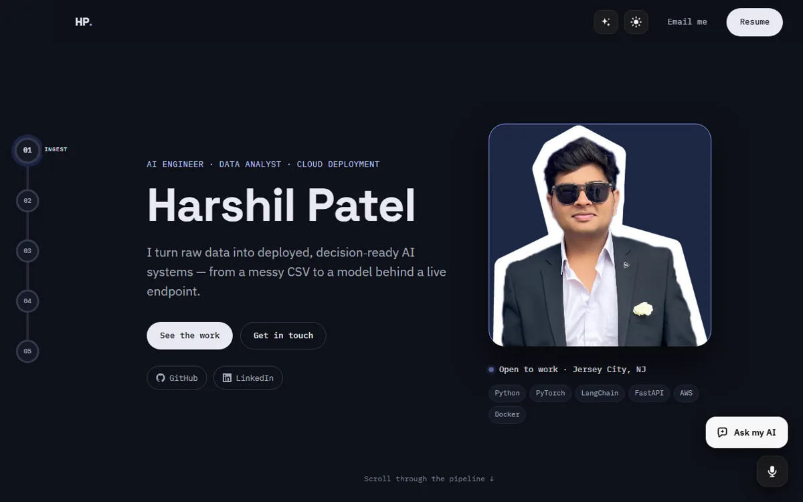

# Harshil Patel · Portfolio

**▶ [harshilmayurpatel.github.io](https://harshilmayurpatel.github.io/)**

My personal site, built as a data pipeline you scroll through: **Ingest → Process → Build → Stack → Deploy**. Plain HTML, CSS and JavaScript, with no framework, build step or dependencies.

[](https://harshilmayurpatel.github.io/)

## Highlights
- **Ask my AI:** a chat on every page that answers questions about my background. It is a RAG service I built and host separately: [ask-my-ai](https://github.com/harshilmayurpatel/ask-my-ai).
- **Voice control:** the mic button understands commands like "dark mode", "show projects" or "open Sokoban". Sentences it doesn't recognize are sent to the AI, which maps them to a site action.
- **All projects page** ([/projects](https://harshilmayurpatel.github.io/projects/)): search, filters and a case study for each project, with deep links like `#sokoban`.
- **Animated previews:** each project plays a short intro animation, keeps one element looping, and replays on hover. Loops pause when off-screen and respect "reduce motion".
- **Light and dark themes** with a ripple transition. Every visit starts in light mode.
- **Fast and accessible:** semantic HTML, keyboard support, visible focus styles and WebP images.

## Structure
```
index.html                 Home: the pipeline sections
projects/
  index.html               All projects page
  data.js                  Project list and case studies (single source of truth)
  projects.js, .css        Filters, cards, previews and the case-study panel
assets/
  css/styles.css           Site styles, themes and animations
  js/app.js                Navigation, theme, scroll rail and voice commands
  js/askai.js              Ask my AI chat panel (streams from the API)
  js/celebrate.js          The ✨ greeting card with local weather
  resume/                  Resume PDF
.github/workflows/static.yml   Deploys to GitHub Pages on every push
```

## Run locally
Serve the folder with any static server:
```bash
python -m http.server 8765
```
Then open http://localhost:8765. The Ask my AI button needs the [API](https://github.com/harshilmayurpatel/ask-my-ai) running, either locally or on Render.

## Add a project
Add one object to [`projects/data.js`](projects/data.js). Screenshots go in `projects/img/<slug>/`.
